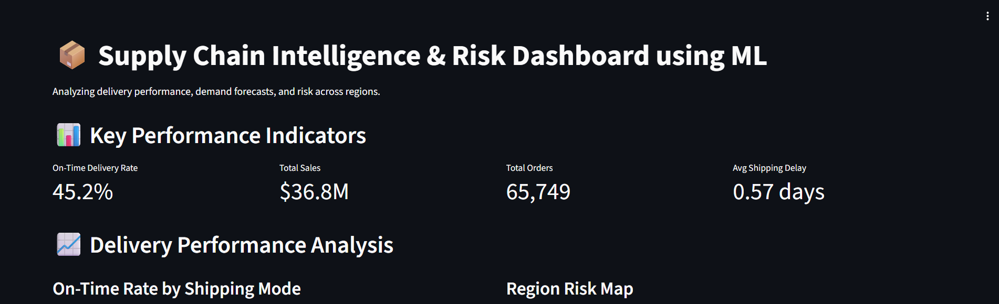
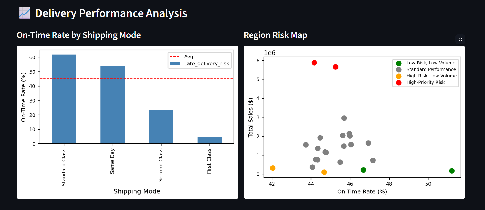
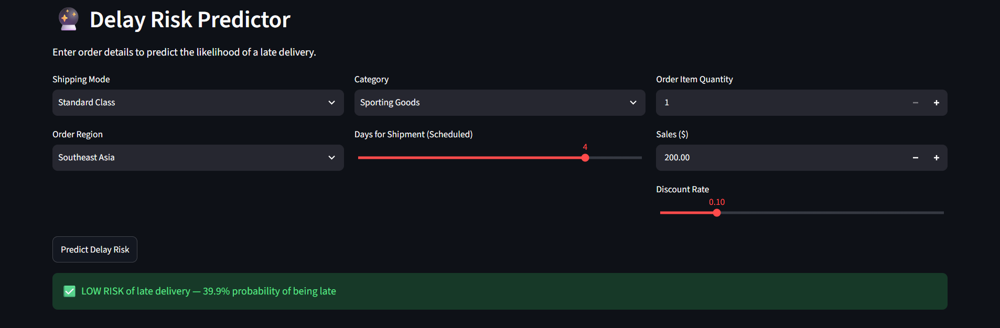

# Supply Chain Intelligence & Risk Dashboard

A two-service supply-chain analytics application. The Streamlit dashboard provides the user interface; a FastAPI backend serves historical summaries and Random Forest predictions. User accounts use Argon2 password hashes and signed, expiring JWT sessions. Render Postgres stores accounts persistently in deployment.

## Architecture

```text
Browser
  └── Streamlit dashboard
        ├── signup/sign-in ──> FastAPI authentication endpoints
        ├── dashboard data ──> FastAPI analytics endpoint
        └── delay estimate ──> FastAPI prediction endpoint
                                  ├── cleaned CSV data
                                  ├── saved Random Forest model
                                  └── Render Postgres user store
```

The Streamlit server calls the API over Render's private network. The FastAPI service is configured as a private service, so it has no public URL; the browser does not call the model API directly. Dashboard and prediction routes require a signed bearer token. `/health` is available on the internal network; interactive API docs are enabled locally and disabled on Render.

## What it shows

- On-time delivery rate, total sales, unique orders, and average difference between actual and scheduled shipping days.
- On-time performance by shipping mode and regional risk segments compared with sales exposure.
- Order-level classification of the historical `Late_delivery_risk` target as 0 or 1, with the model's probability estimate.
- Account creation, sign-in, sign-out, and 30-minute signed access tokens.

The included data contains 180,516 order-item rows and 65,749 distinct order IDs. It is historical DataCo data, not a live order feed. The classifier estimates a supplied historical label; it does not predict exactly how many days late an order will be. Its probability is not documented as calibrated.

## Run locally

Use Python 3.11.10. Create a virtual environment and install all dependencies:

```powershell
python -m venv .venv
.venv\Scripts\Activate.ps1
python -m pip install --upgrade pip
pip install -r requirements.txt
$env:JWT_SECRET_KEY = python -c "import secrets; print(secrets.token_hex(32))"
$env:LOCAL_AUTH_DB_PATH = "$PWD\Data\auth_local.db"
```

Start the API in terminal 1:

```powershell
uvicorn backend.main:app --host 127.0.0.1 --port 8000
```

Start the dashboard in terminal 2:

```powershell
$env:API_HOST = "127.0.0.1"
$env:API_PORT = "8000"
streamlit run app.py
```

Open `http://localhost:8501`. Local accounts use SQLite at the ignored `Data/auth_local.db`; when running on Render, the API requires `DATABASE_URL` and uses managed Postgres instead. Do not reuse a production JWT secret locally or commit one to Git.

## API routes

- `POST /api/v1/auth/signup` — create a username/email account; passwords must be at least 12 characters.
- `POST /api/v1/auth/login` — verify username or email and password; returns a signed JWT with a 30-minute expiry.
- `GET /api/v1/auth/me` — verify the current token and return its user identity.
- `GET /api/v1/dashboard` — KPIs, shipping-mode performance, regional data, and allowed prediction categories.
- `POST /api/v1/predict` — validate user inputs and return the classifier's class and late-risk probability.

## Deploy on Render

[`render.yaml`](render.yaml) defines two Starter web services in Singapore plus a paid Postgres database:

1. `supply-chain-api` runs FastAPI, generates a JWT signing secret, and connects to Postgres.
2. `supply-chain-dashboard` runs Streamlit and receives the API's private hostname and port from Render.
3. `supply-chain-users` stores account records using a managed database connection string.

To deploy, connect the GitHub repository to **New → Blueprint** in Render, inspect the service/database plans and current charges, then apply the Blueprint. The API is private and the dashboard connects to its internal hostname. Render's free Postgres databases expire after 30 days and do not provide backups, so the Blueprint uses a paid persistent database. Review the costs in Render before applying; no Render service has been created by this repository change. ([Blueprint reference](https://render.com/docs/blueprint-spec), [private services](https://render.com/docs/private-services), [Postgres connections](https://render.com/docs/postgresql-creating-connecting))

## Important files

```text
backend/main.py              FastAPI routes, validation, model loading, prediction
backend/auth.py              Argon2 password hashing, JWT issue/verification, DB access
app.py                       Streamlit UI and account/session handling
Data/cleaned_data.csv        Cleaned historical order rows
Data/region_clusters.csv     Regional summaries and precomputed cluster IDs
models/rf_delay_model.pkl    Saved Random Forest classifier
models/model_columns.pkl     Ordered classifier feature schema
models/prophet_model.pkl     Forecast artifact; not used in the running app
models/kmeans_model (1).pkl  Clustering artifact; cluster results are precomputed
models/scaler.pkl            Scaler artifact; not used in the running app
requirements*.txt             Pinned API, dashboard, and common dependencies
render.yaml                  Render services, Postgres, secrets, and health checks
.python-version              Python runtime version
.streamlit/config.toml       Streamlit server settings
```

## Model and data limitations

- The source is the [DataCo Smart Supply Chain dataset on Kaggle](https://www.kaggle.com/datasets/shashwatwork/dataco-smart-supply-chain-for-big-data-analysis). The repository includes a reduced historical extract, not the raw dataset or live operational data.
- The training notebooks/scripts and data-splitting/evaluation process are absent. The README's reported 0.73 ROC-AUC and 8.13% Prophet MAPE cannot be reproduced from the repository alone.
- Prophet and SHAP are not used by the running dashboard. The app does not render a demand forecast or feature explanation.
- User accounts are stored persistently in Render Postgres; a new deployment does not silently fall back to an ephemeral local database.

## Security and production boundary

This version uses Argon2 password hashing, a required random JWT secret, issuer/audience/expiry/signature checks, input validation, database-backed signup/login throttles, and persistent Postgres on Render. Sign-up does not verify email ownership; there is no password reset, MFA, account administration, or edge-level abuse monitoring. Add those controls and independent security review before using this as an operational system with real employees or sensitive data. The model itself is also not validated for current operational decisions.

## Screenshots

### Dashboard overview


### Delivery performance


### Delay risk predictor


## Author

Vinayak Nair
