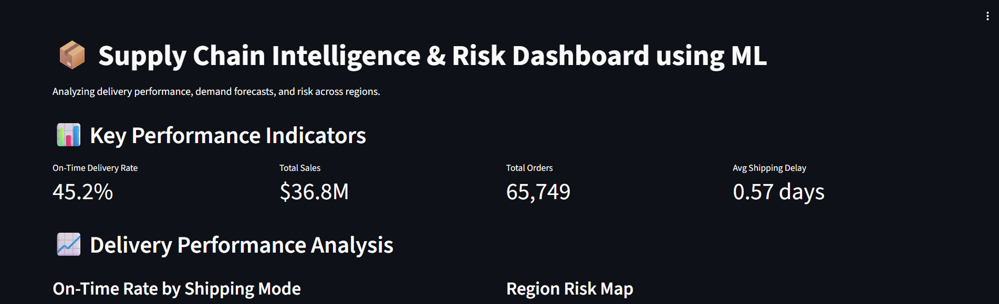
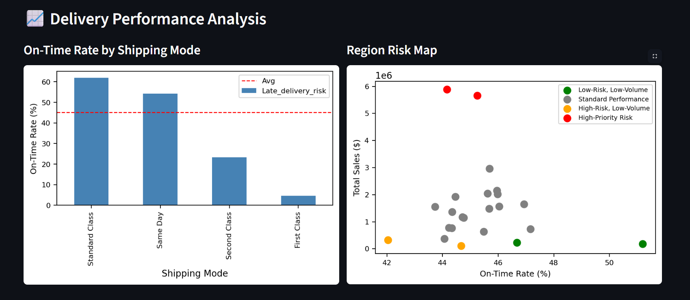
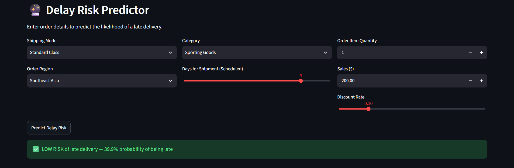

# Supply Chain Intelligence & Risk Dashboard

An end-to-end analytics project that examines historical e-commerce orders, highlights delivery-risk patterns, and estimates delay risk for a user-entered order. The interactive app is built with Streamlit and uses the DataCo Smart Supply Chain dataset.

## What is included

- KPI summary for on-time delivery, sales, order count, and the average difference between actual and scheduled shipping days.
- Shipping-mode comparison and regional risk segmentation visualizations.
- A Random Forest classifier that estimates whether an order is at risk of late delivery.
- Saved Prophet, K-means, and Random Forest artifacts, plus the model feature schema.
- Cleaned order data and a regional summary table.

The repository contains a saved Prophet artifact, but the current Streamlit app does not render a demand forecast. The training notebooks/scripts used to create the saved models are not included, so the model results cannot be independently reproduced from this repository alone.

## Findings reported by the original analysis

The project analysis reports 180,516 order rows, about $36.7M in sales, and an overall on-time rate near 45%. It identifies First Class and Second Class shipping as having high late-delivery rates and flags Western Europe and Central America as high revenue-exposure regions. It also reports 8.13% MAPE for a Prophet forecast and 0.73 ROC-AUC for the delay classifier.

These are the original project's reported findings and metrics; this repository does not include the analysis pipeline needed to recalculate them. The data covers historical orders from 2015–2017, so predictions should be treated as educational decision support rather than current operational guidance. A model probability is not a calibrated guarantee of a late delivery.

## Run locally

Use Python 3.11 in a virtual environment. From the repository root:

```bash
python -m venv .venv
# Windows PowerShell
.venv\Scripts\Activate.ps1
# macOS/Linux: source .venv/bin/activate
python -m pip install --upgrade pip
pip install -r requirements.txt
streamlit run app.py
```

The app reads files relative to `app.py`, so it can be launched from another working directory. The cleaned CSV and model artifacts are included in the repository.

## Repository layout

```text
Data/
  cleaned_data.csv       Cleaned order-level data used by the dashboard
  region_clusters.csv    Precomputed regional clusters and summary metrics
models/
  rf_delay_model.pkl     Trained late-delivery classifier
  model_columns.pkl      Ordered feature schema for the classifier
  prophet_model.pkl      Saved demand-forecast model (not currently shown in the app)
  kmeans_model (1).pkl   Saved regional clustering model
  scaler.pkl             Saved feature scaler
screenshots/              Dashboard screenshots
app.py                    Streamlit dashboard
requirements.txt          Python dependencies
```

## Dataset and model notes

The source dataset is the [DataCo Smart Supply Chain dataset on Kaggle](https://www.kaggle.com/datasets/shashwatwork/dataco-smart-supply-chain-for-big-data-analysis). The repository includes a cleaned, reduced set of columns rather than the complete raw source data.

The classifier artifact was serialized with scikit-learn 1.6.1. Use that version when loading the model to avoid cross-version pickle warnings. Only load model artifacts from a source you trust.

## Screenshots

### Dashboard overview


### Delivery performance


### Delay risk predictor


## Limitations

- The Streamlit app currently displays delivery and regional analytics plus the delay predictor; it does not display a demand forecast or SHAP explanations.
- Training and evaluation code is not included, so the model metrics and reported findings cannot be reproduced from this repository alone.
- Data is historical and does not update from live orders or carrier systems.
- The risk prediction reflects patterns in the training dataset and should not be used as a standalone operational decision.

## Author

Vinayak Nair
